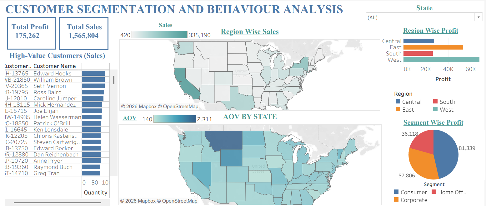

# Customer Segmentation & Behaviour Analysis (Tableau)

A Tableau dashboard showing **which customers, segments, regions and states drive sales and profit**.

## Business questions
- Which regions and states bring in the most sales and profit?
- Which customer segment is most profitable?
- Who are the highest-value customers?
- Where is the average order value highest?

## Dataset
US Superstore sales, 2019 to 2020: 5,901 order lines, 3,003 orders, 773 customers.

## Dashboard

**KPIs:** total sales ($1,565,804) and total profit ($175,262)
**Visuals:** sales by state (map), average order value (AOV) by state (map), profit by region, profit by segment, ranked list of high-value customers, with a state filter.

## Key findings
- **The West is the most profitable region** ($67.9K), followed by the East ($53.4K).
- **Consumers are the most profitable segment** ($81.3K), ahead of Corporate ($57.8K) and Home Office ($36.1K).
- **Average order value is $521** across all orders, but varies widely by state.

## How to open
Open `dashboard/Customer_Segmentation_and_Behaviour_Analysis.twb` in Tableau Desktop or Tableau Public. If prompted, point the data source to `data/SuperStore_Sales_Dataset.csv`.

## Tools
Tableau
